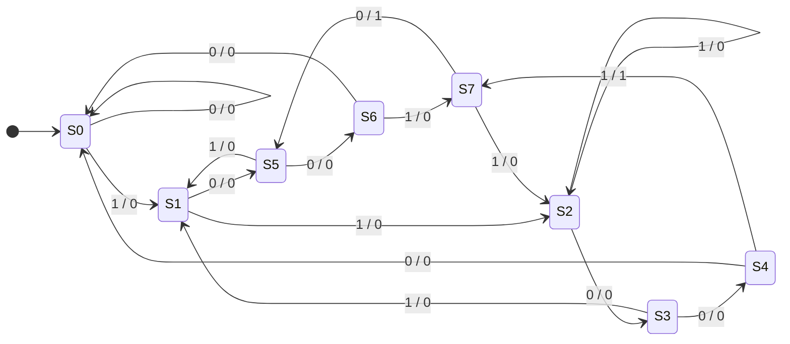

# Sequence Detector — 11001 & 10010 (MATLAB / Octave)

A serial bit-stream detector that outputs **1** on the exact step where the pattern
`11001` **or** `10010` has just been completed, and **0** otherwise.
Overlapping occurrences are detected too — e.g. `110010` fires twice, once for each pattern.

The detector is implemented in two equivalent ways and verified with an
**exhaustive test** (all 4096 inputs of 12 bits) and a **Monte Carlo test** (100 000 random bits)
against an independent reference model.

| Implementation | File | Idea | State |
|---|---|---|---|
| Shift register | [`src/detector.m`](src/detector.m) | keep the last 5 bits, compare the window with both patterns | 5 bits (32 states) |
| Mealy FSM | [`src/detector_fsm.m`](src/detector_fsm.m) | minimal finite-state machine built from the pattern prefixes | 8 states (3 flip-flops) |

## The finite-state machine

Each state is the longest suffix of the input seen so far that is still the start of one of the patterns.
Transitions are labelled `input / output`.

| State | Meaning (bits matched) | next on 0 / out | next on 1 / out |
|---|---|---|---|
| S0 | `""` (start) | S0 / 0 | S1 / 0 |
| S1 | `1` | S5 / 0 | S2 / 0 |
| S2 | `11` | S3 / 0 | S2 / 0 |
| S3 | `110` | S4 / 0 | S1 / 0 |
| S4 | `1100` | S0 / 0 | **S7 / 1** ← `11001` |
| S5 | `10` | S6 / 0 | S1 / 0 |
| S6 | `100` | S0 / 0 | S7 / 0 |
| S7 | `1001` | **S5 / 1** ← `10010` | S2 / 0 |



After a detection the FSM does not go back to S0: it keeps the overlapping suffix
(`11001` → S7 = `1001`, `10010` → S5 = `10`), which is why chains like `1100100` are detected correctly.
The state table was derived with the classic prefix/suffix construction and checked to be minimal (no two states are equivalent).

## Project structure

```
sequence-detector-fsm/
├── src/
│   ├── detector.m          # shift-register detector (one bit per call)
│   ├── detector_fsm.m      # 8-state Mealy FSM detector (one bit per call)
│   ├── run_detector.m      # runs a whole bit vector through either detector
│   └── reference_detect.m  # strfind-based reference model for the tests
├── tests/
│   └── test_detector.m     # exhaustive + Monte Carlo verification
└── examples/
    └── demo.m              # short stream, printed result and plot
```

## How to run

Works in **MATLAB** (R2016b or newer, no toolboxes needed) and in **GNU Octave**.
From the repository root:

```matlab
run tests/test_detector.m   % verification
run examples/demo.m         % example + plot
```

or from a terminal with Octave:

```bash
octave-cli --eval "run tests/test_detector.m"
octave-cli --eval "run examples/demo.m"
```

Using a detector in your own code:

```matlab
addpath src
out = run_detector([1 1 0 0 1 0 0 1 0], 'fsm');   % -> 0 0 0 0 1 1 0 0 1
```

## Verification

**Exhaustive test.** Every 12-bit sequence (2¹² = 4096) is fed to both detectors and compared bit-by-bit
with `reference_detect`, which finds all overlapping matches with `strfind`. 12 bits is long enough to
contain repeated and overlapping patterns, so both detections and false alarms are checked.

**Monte Carlo test.** 100 000 random bits (fixed seed) are checked against the reference model.
Coverage is reported as the share of the 32 possible 5-bit windows seen in the input and of the
16 FSM transitions taken. The number of detections is close to the theoretical 2/32 · 100 000 ≈ 6250.

Output of `tests/test_detector.m` (GNU Octave):

```text
==== Exhaustive test: all 12-bit inputs (4096 sequences) ====
  shift  PASS 4096 / 4096   FAIL 0
  fsm    PASS 4096 / 4096   FAIL 0

==== Monte Carlo test: 100000 random bits ====
  shift  detections 6332 (reference 6332)   mismatches 0
  fsm    detections 6332 (reference 6332)   mismatches 0
  expected about L*2/32 = 6250 detections
  5-bit pattern coverage:  32 / 32  (100.0%)
  FSM transition coverage: 16 / 16  (100.0%)

ALL TESTS PASSED
```

Output of `examples/demo.m`:

```text
step :   1  2  3  4  5  6  7  8  9 10 11 12 13 14 15 16 17 18 19 20 21 22 23 24 25 26 27 28
in   :   0  1  1  0  0  1  0  0  1  0  1  1  1  0  0  0  1  1  0  0  1  1  0  1  0  0  1  0
out  :   0  0  0  0  0  1  1  0  0  1  0  0  0  0  0  0  0  0  0  0  1  0  0  0  0  0  0  1

step  6: [11001] -> 11001 detected
step  7: [10010] -> 10010 detected
step 10: [10010] -> 10010 detected
step 21: [11001] -> 11001 detected
step 28: [10010] -> 10010 detected
```

## About

University assignment for *Design and Simulation of Systems* (Digital Systems, University of Thessaly, 2025–26).
The original submission used the shift-register approach; the explicit Mealy FSM, the Octave
compatibility and the extended test suite were added for this repository.

**Author:** Ioannis Zafeiris
